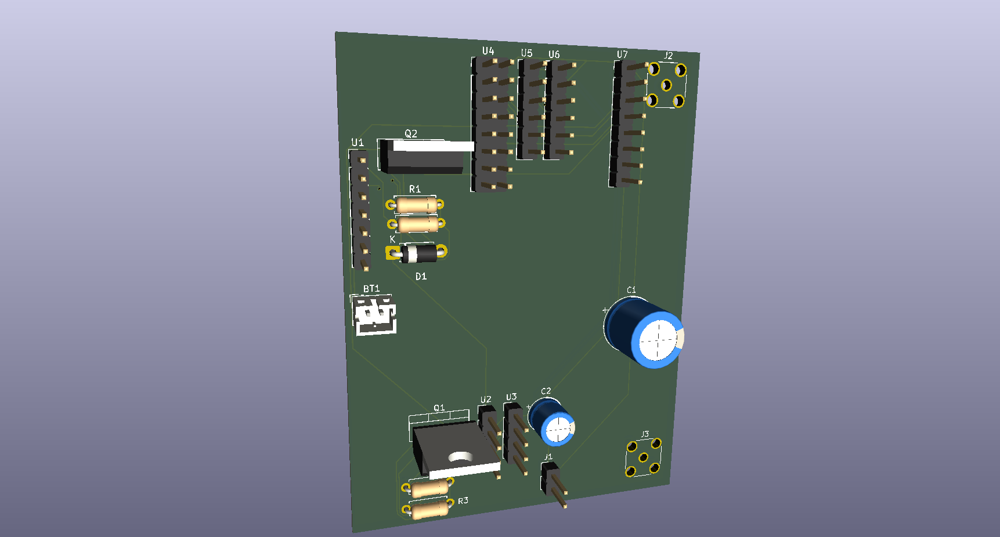
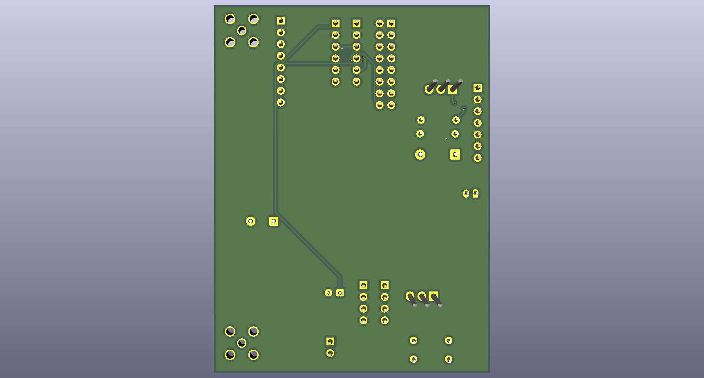

# Trackpoint IoT Tracker

Trackpoint is an IoT tracking solution featuring custom hardware and a companion Flutter mobile application. The system is designed to track location and telemetry, utilizing an ESP32 microcontroller for processing and a SIM7080G module for cellular connectivity. 

## Software
The mobile application is built using **Flutter** and can be found in the `lib/` directory. It interfaces with Firebase for real-time database updates and utilizes BLE (Bluetooth Low Energy) for local device configuration.

## Hardware & PCB
The hardware consists of a custom-designed PCB built around the ESP32 and SIM7080G (LTE-M/NB-IoT). Power management is handled via a TP4056 charging circuit and a boost converter, allowing the device to run off a 3.7V 2000mAh Li-Po battery.

The KiCad source files (`.kicad_sch`, `.kicad_pcb`, and `.kicad_pro`) are located in the root directory. 

### 3D PCB Layout (Front)

### 3D PCB Layout (Back)



## 🛠️ Getting Started (Software)
Before running ensure build with:

```bash
flutter analyze
flutter test
```

To build the Flutter app, ensure you have the Flutter SDK installed:

```bash
flutter pub get
flutter run
```
